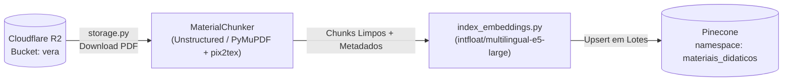

# Pipeline de Ingestão de PDFs e Banco Vetorial (Pinecone)

---

## 1. Arquitetura do Índice Vetorial (`vera-math-index`)

O banco vetorial **Pinecone** centraliza a memória semântica do sistema em um índice de **1024 dimensões** com métrica de similaridade **cosseno**, particionado em dois namespaces lógicos:

| Namespace | Conteúdo | Origem / Script de Carga | Consumidor Principal |
|---|---|---|---|
| **`materiais_didaticos`** | Chunks conceituais e teóricos extraídos de apostilas e livros didáticos de Matemática do Ensino Médio (armazenados no Cloudflare R2). | `app/pipeline/chunking.py` + `app/pipeline/index_embeddings.py` | `ChatService` (Tutora Virtual VERA) |
| **`questoes_enem`** | Vetores dos enunciados das **402 questões históricas** do ENEM com metadados completos (`habilidade`, `ano`, `co_item`, `gabarito`, `alternativas`). | `scripts/seed_questoes_pinecone.py` | `QuestionService` (RAG *Few-Shot* para geração PoT) |

---

## 2. Regras de Negócio de Ingestão e Vetorização (`RN-CHUNK01`..`03`, `RN-VETOR01`)

### `RN-CHUNK01` — Segmentação Semântica Hierárquica com Fallback Automático
- **Prioridade 1 (Unstructured)**: O `MaterialChunker` (`app/pipeline/chunking.py`) prioriza particionamento semântico via `chunk_by_title`, preservando a coesão de seções didáticas.
  - Parâmetros: `max_characters = CHUNK_SIZE` (padrão `1200`), `new_after_n_chars = int(CHUNK_SIZE * 0.75)` (`900`), `combine_text_under_n_chars = 400`.
- **Prioridade 2 (Fallback PyMuPDF)**: Ativado automaticamente quando o Unstructured retorna 0 chunks (PDF com layout complexo/duas colunas) ou lança exceção. Extrai blocos em ordem de leitura natural, normaliza símbolos matemáticos Unicode para LaTeX inline e aplica janela deslizante com overlap.

### `RN-CHUNK02` — Limites de Janela, Limpeza de Ruído e Descarte de Fragmentos Curtos
- Os limites são controlados por `CHUNK_SIZE` (`1200`) e `CHUNK_OVERLAP` (`150`).
- **Filtros de Ruído**:
  - Descarte de elementos estruturais do tipo `Header`, `Footer` e `PageNumber`, bem como cabeçalhos editoriais repetitivos (`HEADER_REGEX`) e seções de referências bibliográficas (`REF_TITLE_REGEX` e `_has_reference_signals`).
  - **Filtro de Tamanho Mínimo**: descarta fragmentos residuais menores que `MIN_CHUNK_WORDS = 15` palavras (`MIN_WORDS_UNSTRUCTURED = 20` no fluxo Unstructured), evitando que títulos isolados poluam a busca vetorial. O script `scripts/clean_tiny_chunks.py` permite auditoria e limpeza retroativa no Pinecone.
- **Metadados Semânticos Puros**: `parse_metadata_from_filename` extrai `filename`, `title`, `topic` e `source_type="materiais_didaticos"` sem forçar mapeamento artificial de habilidades nos PDFs teóricos.

### `RN-CHUNK03` — Extração de Fórmulas Matemáticas via OCR (`pix2tex`)
- Quando `FORMULA_EXTRACTION_ENABLED=True`, o extrator PyMuPDF (`app/pipeline/formula_extractor.py`) identifica regiões de imagem candidatas a equações matemáticas e executa OCR via **pix2tex (LaTeX-OCR)**.
- As fórmulas reconhecidas são injetadas diretamente no fluxo textual do chunk em notação display LaTeX (`$$...$$`).

### `RN-VETOR01` — Padronização de Embeddings (`multilingual-e5-large`)
- Todos os vetores (1024 dimensões) são gerados localmente pelo modelo **`intfloat/multilingual-e5-large`** (`PineconeVectorStore` em `app/services/vectorstore.py`).
- **Sanitização UTF-8**: antes da vetorização e do upsert no Pinecone, textos e metadados passam por `sanitize_utf8_string` e `sanitize_metadata` (`app/core/sanitizer.py`) para remover caracteres surrogates ou bytes inválidos oriundos de PDFs.

---

## 3. Fluxo de Ingestão com Cloudflare R2

---

## Notas Relacionadas

- [Visão Arquitetural e Infraestrutura](./visao-arquitetural.md)
- [Fluxo da Tutora Virtual VERA (Chat RAG)](../02-dominios-e-fluxos/tutoria-rag-chat.md)
- [Pipeline PoT de Geração de Questões Inéditas](../02-dominios-e-fluxos/geracao-questoes-pot.md)
