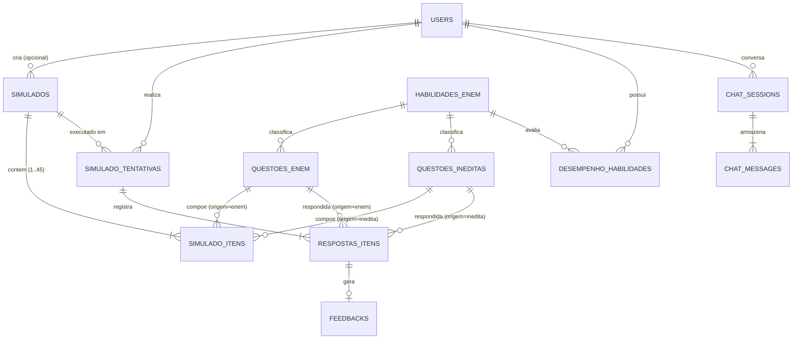

# Modelo de Dados e Persistência Relacional (PostgreSQL)

O banco de dados relacional (**PostgreSQL 15**, gerenciado via SQLAlchemy 2.0 `Mapped` em `app/db/models/`) garante a integridade referencial, o controle de acesso, a auditoria das questões geradas e a persistência histórica de simulados e sessões de tutoria.

---

## 1. Diagrama Entidade-Relacionamento (ERD)

---

## 2. Catálogo das 10 Tabelas Relacionais

### 2.1 Autenticação e Matriz Curricular

1. **`users` (`app/db/models/user.py`)**:
   - **Chave primária**: `id` (`UUID`).
   - **Colunas**: `nome`, `email` (`UNIQUE`, indexado), `hashed_password` (Bcrypt), `role` (`'student'` ou `'admin'`), `is_ativo` (`Boolean`), `created_at`, `updated_at` (`TimestampMixin`).
2. **`habilidades_enem` (`app/db/models/habilidade.py`)**:
   - **Chave primária**: `codigo` (`String(10)`, ex.: `'H01'` a `'H30'`).
   - **Colunas**: `competencia` (`Integer`, `1` a `7`), `descricao` (`Text`), `eixo_tematico` (`String(100)`).
   - **População inicial**: `scripts/seed_habilidades.py` / `scripts/seed_habilidades.sql`.

### 2.2 Acervo de Questões (Históricas e Inéditas)

3. **`questoes_enem` (`app/db/models/questao_enem.py`)**:
   - Acervo histórico oficial dos microdados do INEP (2009–2024), totalizando **402 questões textuais** de Matemática sem dependência de imagem obrigatória no enunciado.
   - **Colunas**: `id` (`UUID`), `ano` (`Integer`), `habilidade_codigo` (`FK -> habilidades_enem.codigo`), `co_item` (`Integer UNIQUE`, código oficial INEP), `enunciado` (`Text`), `alternativas` (`JSONB` com chaves `"A"` a `"E"`), `gabarito` (`String(1)`), `metadados` (`JSONB`, parâmetros TRI e cor da prova), `created_at`.
4. **`questoes_ineditas` (`app/db/models/questao_inedita.py`)**:
   - Questões geradas pelo pipeline PoT e aprovadas na validação em 3 etapas.
   - **Colunas**:
     - `id` (`UUID`), `habilidade_codigo` (`FK -> habilidades_enem.codigo`).
     - `enunciado` (`Text`, já formatado com eventual tabela Markdown).
     - `alternativas` (`JSONB`, dicionário `"A"` a `"E"` montado por código).
     - `gabarito` (`String(1)`, atribuído deterministicamente por código — **RN-Q02**).
     - `justificativa` (`Text`, armazena a `resolucao_passo_a_passo` autêntica da Resolução Cega — **RN-Q04**).
     - `thought_scratchpad` (`Text`, armazena o código-fonte Python da função `def resolver()` para auditoria — **RN-Q04**).
     - `is_validated` (`Boolean`, padrão `True`), `created_at`.

### 2.3 Simulados, Tentativas e Diagnóstico

5. **`simulados` (`app/db/models/simulado.py`)**:
   - Cabeçalho de um caderno de prova gerado.
   - **Colunas**: `id` (`UUID`), `user_id` (`FK -> users.id`, opcional), `titulo`, `descricao`, `tipo` (`'diagnostico'`, `'treino'`, etc.), `created_at`.
6. **`simulado_itens` (`app/db/models/simulado.py`)**:
   - Associa as 45 questões ao simulado preservando a numeração (`ordem` de `1` a `45`).
   - **Padrão *Exclusive Arc* (`chk_simulado_item_origem`)**: garante via `CheckConstraint` que se `origem_questao = 'enem'`, então `questao_enem_id IS NOT NULL` e `questao_inedita_id IS NULL` (e vice-versa para `'inedita'`).
   - **Constraint de unicidade**: `uq_simulado_item_ordem` (`simulado_id`, `ordem`).
7. **`simulado_tentativas` (`app/db/models/submission.py`)**:
   - Registro de uma execução de prova pelo estudante.
   - **Colunas**: `id` (`UUID`), `user_id` (`FK -> users.id`), `simulado_id` (`FK -> simulados.id`), `status` (`'in_progress'` ou `'completed'`), `total_itens`, `total_acertos`, `score_percentual` (`Float`), `started_at`, `completed_at`.
8. **`respostas_itens` (`app/db/models/submission.py` — classe `RespostaItem`)**:
   - Resposta marcada pelo estudante para cada item da tentativa.
   - Utiliza o mesmo padrão *Exclusive Arc* (`chk_resposta_item_origem`) apontando para `questao_enem_id` ou `questao_inedita_id`, além de `alternativa_marcada` (`String(1)`), `is_correta` (`Boolean`) e `tempo_gasto_segundos`.
9. **`desempenho_habilidades` (`app/db/models/history.py` — classe `DesempenhoHabilidade`)**:
   - Tabela agregadora de diagnóstico contínuo por estudante e habilidade (`uq_user_habilidade_desempenho`).
   - **Colunas**: `total_questoes`, `total_acertos`, `taxa_acerto` (`Float`), `nivel_dominio` (`'critico'`, `'em_desenvolvimento'`, `'consolidado'`), `updated_at`.
10. **`feedbacks` (`app/db/models/feedback.py` — classe `Feedback`)**:
    - Armazena feedbacks individuais gerados para erros em `respostas_itens` (`resposta_item_id UNIQUE`), com `feedback_content`, `thought_scratchpad` e `context_chunks` (`JSONB`).

### 2.4 Tutoria Conversacional (Chat RAG)

11. **`chat_sessions` e `chat_messages` (`app/db/models/chat.py`)**:
    - `chat_sessions`: `id` (`String(100)`, PK), `user_id` (`FK -> users.id`), `titulo` (gerado a partir da 1ª pergunta), `created_at`, `updated_at`.
    - `chat_messages` (`ChatMessageModel`): `id` (`UUID`), `session_id` (`FK -> chat_sessions.id`), `role` (`'user'`, `'assistant'`, `'system'`), `content` (`Text`, resposta limpa), `thought` (`Text`, bloco `<pensamento>` extraído), `context_chunks` (`JSONB`, trechos recuperados do Pinecone), `created_at`.

---

## Notas Relacionadas

- [Visão Arquitetural e Infraestrutura](./visao-arquitetural.md)
- [Fluxo de Simulados e Diagnóstico](../02-dominios-e-fluxos/simulados-e-diagnostico.md)
- [Pipeline PoT de Geração de Questões Inéditas](../02-dominios-e-fluxos/geracao-questoes-pot.md)
- [Fluxo da Tutora Virtual VERA (Chat RAG)](../02-dominios-e-fluxos/tutoria-rag-chat.md)
