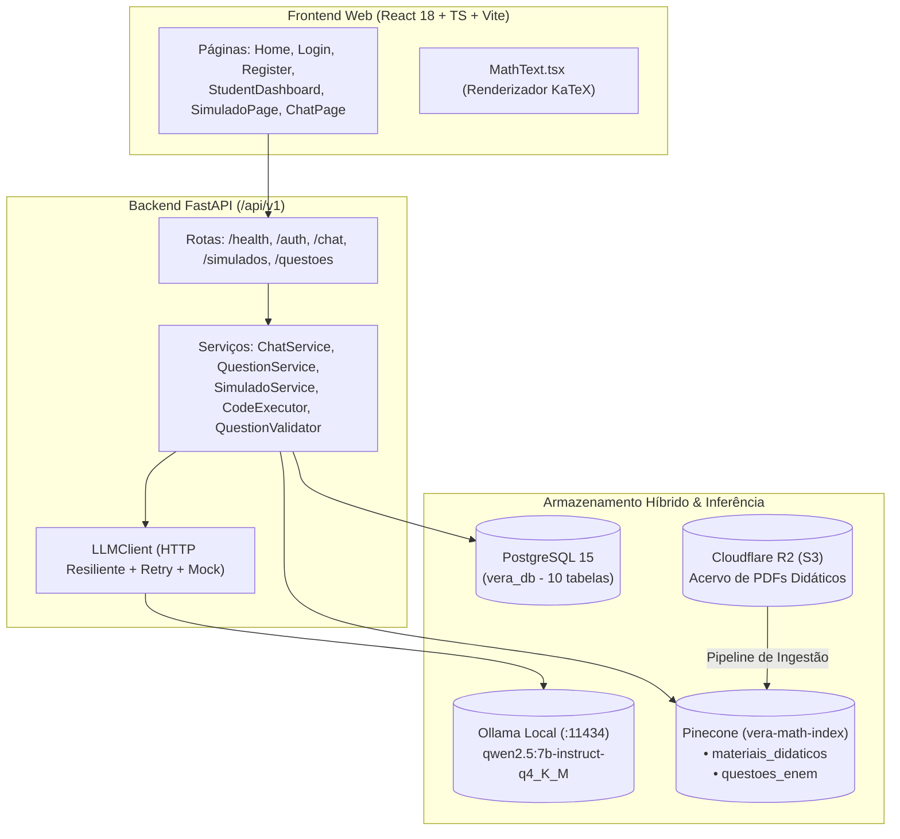

# Visão Arquitetural, Infraestrutura Local e Rotas da API

---

## 1. Topologia dos Módulos do Sistema

### Camadas Principais

1. **Frontend Web (`frontend/`)**: SPA em React 18 + TypeScript + Vite com Design System proprietário em Vanilla CSS (*Ocean & Coral Palette*) e renderização de fórmulas via KaTeX (`MathText.tsx`).
2. **Backend e API (`app/`)**: FastAPI assíncrono, injeção de dependências tipadas (`app/api/deps.py`), validação Pydantic v2 (`app/schemas/`) e autenticação stateless via JWT (`HS256`, expiração padrão de 24h / 1440 min) + hash de senhas Bcrypt (`app/core/security.py`).
3. **Inferência Local (`app/services/llm_client.py`)**: Comunicação direta com o daemon local do Ollama executando `qwen2.5:7b-instruct-q4_K_M`.
4. **Armazenamento Híbrido**:
   - **PostgreSQL 15**: dados relacionais transacionais e auditoria pedagógica.
   - **Pinecone (`vera-math-index`)**: busca semântica em 1024 dimensões (`intfloat/multilingual-e5-large`, métrica cosseno) dividida nos namespaces `materiais_didaticos` e `questoes_enem`.
   - **Cloudflare R2**: Object Storage S3-compatível para armazenamento dos PDFs didáticos originais (`app/services/storage.py`).

---

## 2. Regras de Infraestrutura e Inferência Local (`RN-INF01` a `RN-INF04`)

| Código | Regra de Negócio | Implementação no Código |
|---|---|---|
| **RN-INF01** | **Variáveis de Ambiente Configuráveis**: o endpoint do LLM e o modelo devem ser lidos obrigatoriamente de `LLM_ENDPOINT_URL` (padrão: `http://localhost:11434`) e `LLM_MODEL` (padrão: `qwen2.5:7b-instruct-q4_K_M`). | `Settings` em `app/core/config.py` e `LLMClient.__init__` em `app/services/llm_client.py`. |
| **RN-INF02** | **Health-Check Proativo**: a API disponibiliza o endpoint `GET /api/v1/health` que inspeciona a conectividade com o Ollama (`/api/tags`), PostgreSQL e Pinecone. | `app/api/v1/health.py` e `LLMClient.health_check()`. |
| **RN-INF03** | **Resiliência com Retry e Backoff**: chamadas ao LLM utilizam política de retry exponencial (até 3 tentativas) e timeout estendido (`LLM_TIMEOUT_SECONDS = 300.0`, `LLM_NUM_CTX = 8192`) para absorver picos de carga na GPU/CPU local. | `LLMClient.generate()` e `LLMClient.agenerate()` em `app/services/llm_client.py`. |
| **RN-INF04** | **Modo Mock para Testes**: o `LLMClient` deve manter suporte a `mock_mode=True` (ou respostas simuladas injetáveis) para execução de suítes Pytest desacopladas do hardware de inferência. | `LLMClient(mock_mode=True)` em `app/services/llm_client.py`. |

---

## 3. Variáveis de Ambiente Consolidada (`app/core/config.py`)

| Grupo | Variável | Valor Padrão | Descrição |
|---|---|---|---|
| **API / Auth** | `API_V1_STR` | `"/api/v1"` | Prefixo base das rotas da API |
| | `JWT_SECRET_KEY` | `"vera-jwt-secret-..."` | Chave de assinatura de tokens JWT (`HS256`) |
| | `ACCESS_TOKEN_EXPIRE_MINUTES` | `1440` | Tempo de expiração do token (24h) |
| **LLM (Ollama)** | `LLM_ENDPOINT_URL` | `"http://localhost:11434"` | URL do daemon local do Ollama (**RN-INF01**) |
| | `LLM_MODEL` | `"qwen2.5:7b-instruct-q4_K_M"` | Tag do modelo no Ollama (**RN-INF01**) |
| | `LLM_TIMEOUT_SECONDS` | `300.0` | Timeout máximo por requisição HTTP ao Ollama |
| | `LLM_MAX_TOKENS` | `1024` | Limite padrão de tokens de saída (`num_predict`) |
| | `LLM_NUM_CTX` | `8192` | Janela de contexto configurada no Ollama (`num_ctx`) |
| **Pinecone & E5** | `PINECONE_API_KEY` | `""` | Chave da API Pinecone |
| | `PINECONE_INDEX_NAME` | `"vera-math-index"` | Nome do índice vetorial |
| | `EMBEDDING_MODEL_NAME` | `"intfloat/multilingual-e5-large"` | Modelo local SentenceTransformers (1024 dims) |
| | `NAMESPACE_MATERIAIS_DIDATICOS` | `"materiais_didaticos"` | Namespace de apostilas/livros para a Tutora RAG |
| | `NAMESPACE_QUESTOES_ENEM` | `"questoes_enem"` | Namespace das 402 questões históricas do ENEM |
| **Ingestão / RAG** | `CHUNK_SIZE` / `CHUNK_OVERLAP` | `1200` / `150` | Limites de caracteres do `MaterialChunker` |
| | `FORMULA_EXTRACTION_ENABLED` | `True` | Ativa OCR matemático via `pix2tex` no fallback PyMuPDF |
| | `ENABLE_QUERY_REWRITING` | `True` | Ativa reescrita de consultas no `ChatService` |
| **PostgreSQL** | `DATABASE_URL` | Montada via `POSTGRES_*` | String de conexão `postgresql+psycopg2://...` |
| **Admin Seed** | `ADMIN_EMAIL` / `ADMIN_PASSWORD` | `admin@vera.com` | Credenciais provisionadas no startup |

---

## 4. Mapa de Endpoints da API (`app/api/router.py`)

Todos os endpoints são montados sob `/api/v1` em `app/main.py`:

- **Saúde (`app/api/v1/health.py`)**:
  - `GET /api/v1/health`: status do serviço e conectividade com Ollama (`RN-INF02`).
- **Autenticação (`app/api/v1/auth.py`)**:
  - `POST /api/v1/auth/register`: cadastro de estudante (`role="student"`).
  - `POST /api/v1/auth/login`: autenticação OAuth2/JSON retornando token JWT.
  - `GET /api/v1/auth/me`: perfil do usuário autenticado.
- **Tutora Virtual VERA (`app/api/v1/chat.py`)**:
  - `POST /api/v1/chat` (e `/api/v1/chat/message`): envia mensagem para a tutora RAG com CoT.
  - `GET /api/v1/chat/sessions`: lista sessões persistidas do estudante autenticado.
  - `GET /api/v1/chat/history/{session_id}`: recupera histórico completo de uma sessão.
  - `DELETE /api/v1/chat/history/{session_id}`: remove/limpa uma sessão de conversa.
- **Simulados (`app/api/v1/simulado.py` — prefixo `/api/v1/simulados`)**:
  - `POST /api/v1/simulados/gerar`: cria novo caderno estratificado de 45 questões (`RN-SIM01`).
  - `GET /api/v1/simulados/{simulado_id}`: obtém caderno para realização da prova **sem gabarito/justificativa** (`RN-SIM02`).
  - `POST /api/v1/simulados/{simulado_id}/submeter`: submete respostas, corrige tentativa, atualiza `desempenho_habilidades` e revela gabarito (`RN-SIM03`).
  - `GET /api/v1/simulados/tentativas/me`: histórico de tentativas do estudante.
- **Questões Inéditas e Acervo (`app/api/v1/questoes.py` — prefixo `/api/v1/questoes`)**:
  - `POST /api/v1/questoes/gerar`: dispara pipeline PoT para gerar e validar uma questão inédita para uma habilidade (`RN-Q01` a `RN-Q04`).
  - `POST /api/v1/questoes/popular-lote`: geração em lote para múltiplas habilidades.
  - `GET /api/v1/questoes/ineditas` e `GET /api/v1/questoes/habilidades`: consulta de questões validadas e habilidades da Matriz.

---

## Notas Relacionadas

- [Modelo de Dados e Persistência Relacional (PostgreSQL)](./modelo-relacional.md)
- [Pipeline de Ingestão e Banco Vetorial (Pinecone)](./ingestao-e-vetorizacao.md)
- [Decisões de Engenharia DSR](../00-fundamentos/decisoes-dsr.md)
