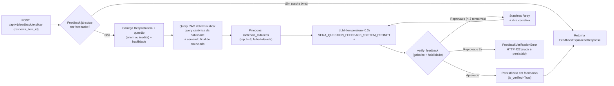

# Feedback Pedagógico Pontual por Item de Simulado (Tutora VERA)

Após a correção de um simulado, o estudante pode solicitar, para cada questão **errada**, uma explicação pedagógica gerada pela Tutora VERA. O fluxo é independente do Chat RAG (`ChatService`) e do pipeline PoT (`QuestionService`): possui prompt, schema e persistência próprios (`FeedbackService` $\rightarrow$ tabela `feedbacks`).

---

## 1. Pipeline de Execução (`FeedbackService.gerar_ou_obter_feedback_item`)

---

## 2. Regras de Negócio (`RN-FB01` a `RN-FB04`)

### `RN-FB01` — Contexto RAG Determinístico por Habilidade
- A query de recuperação é montada por `build_rag_query`: a query conceitual canônica da habilidade (`data/habilidades_queries.json`, campo `query`) concatenada às 2 últimas frases do enunciado (`_extract_final_command`), que normalmente contêm o comando do item.
- A busca usa o namespace `materiais_didaticos` com `top_k=3`. Falhas do Pinecone são registradas em log e o feedback é gerado sem trechos teóricos (degradação graciosa).

### `RN-FB02` — Prompt CoT de Diagnóstico do Distrator
- `VERA_QUESTION_FEEDBACK_SYSTEM_PROMPT` + `build_question_feedback_prompt` (`app/core/prompts.py`) recebem habilidade, enunciado, alternativas, alternativa marcada (`[INCORRETA]`) e gabarito oficial (`[CORRETA]`).
- O modelo deve emitir `<pensamento>` (diagnóstico do distrator, resolução, ancoragem teórica, planejamento) e `<resposta>` (diagnóstico acolhedor, resolução passo a passo em LaTeX `$...$`/`$$...$$` — `RN-CHAT04` — e o que estudar).
- A saída é separada por `parse_cot_response`; `thought_scratchpad` guarda o raciocínio e `feedback_content` a resposta limpa (fallback: texto bruto se `<resposta>` vier vazio).
- Cada tentativa é uma chamada ao `LLMClient.generate` com `temperature=0.3` (até 3 tentativas — ver `RN-FB04`).
- A instrução final do prompt exige que a `<resposta>` afirme explicitamente a alternativa do gabarito, cite apenas a habilidade do item e nunca apresente a alternativa marcada como correta.

### `RN-FB03` — Cache Relacional e Controle de Acesso
- `feedbacks.resposta_item_id` é `UNIQUE`: cada resposta tem no máximo um feedback; requisições repetidas retornam o registro persistido sem nova inferência.
- Só o dono da tentativa (`simulado_tentativas.user_id`) pode gerar ou consultar o feedback (`PermissionError` $\rightarrow$ HTTP `403`). Resposta inexistente $\rightarrow$ `404`; feedback reprovado na verificação $\rightarrow$ `422` (`RN-FB04`); erro de inferência $\rightarrow$ `500`.

### `RN-FB04` — Pós-Processamento: Verificação Automática contra o Gabarito
Implementa o passo 5 do fluxo de feedback do pré-projeto ("o feedback gerado é verificado automaticamente quanto à consistência com o gabarito oficial antes de ser exibido").
- `verify_feedback` (`app/services/feedback_verifier.py`) é **determinístico** (regex + normalização numérica, sem LLM) e analisa apenas o texto exibido (`<resposta>`). Códigos de violação:

| Código | Condição de reprovação |
|---|---|
| `VAZIO` | `<resposta>` com menos de 40 caracteres. |
| `MARCADA_COMO_CORRETA` | Afirma que a alternativa marcada pelo estudante é a correta ("a alternativa B é a correta", "o gabarito é B"). |
| `CORRETA_DIVERGENTE` | Afirma que outra alternativa (nem gabarito, nem marcada) é a correta. |
| `GABARITO_AUSENTE` | Não cita a letra do gabarito ("alternativa C", "letra **C**", "(C)", "C)") **nem** o conteúdo da alternativa correta (todos os números dela, aceitando formatos `1.250,50`/`1250.5`, ou o texto normalizado quando não há números). |
| `HABILIDADE_DIVERGENTE` | Cita código de habilidade (`Hxx`) diferente da habilidade oficial do item (Matriz de Referência). |

- Letras são casadas apenas em maiúscula, para que artigos/conjunções ("é a", "e") não sejam lidos como alternativas A/E.
- **Stateless Retry**: se reprovado, o prompt é reconstruído do zero com uma instrução corretiva (`build_correction_hint`) listando os motivos; até `MAX_FEEDBACK_ATTEMPTS = 3` tentativas.
- Se as 3 tentativas forem reprovadas, `FeedbackVerificationError` é lançada, **nada é persistido** (o cache não guarda alucinações; uma nova solicitação recomeça o ciclo) e a API responde `422`. Só feedbacks aprovados são gravados, com `is_verified=True`.
- Os códigos de violação são estáveis e servem de instrumento para a **taxa de alucinação** da avaliação quantitativa ([baseline-e-metricas-tcc.md](../03-avaliacao-cientifica/baseline-e-metricas-tcc.md)).
- Limitação conhecida: a verificação é léxica — detecta contradições explícitas com o gabarito e ausência de ancoragem, mas não erros aritméticos intermediários da resolução.
- Feedbacks gravados antes desta regra (2026-11-15) receberam `is_verified=True` pelo valor padrão da coluna, sem terem passado pela verificação.

---

## 3. Endpoints (`app/api/v1/feedback.py` — prefixo `/api/v1/feedback`)

| Método | Rota | Descrição |
|---|---|---|
| `POST` | `/feedback/explicar` | Gera (ou retorna do cache) o feedback para `resposta_item_id`. |
| `GET` | `/feedback/{resposta_item_id}` | Retorna o feedback já persistido ou `404`. |

O `resposta_item_id` chega ao frontend no relatório de correção do simulado (`ItemCorrecaoResponse.resposta_item_id`, ver [simulados-e-diagnostico.md](./simulados-e-diagnostico.md)).

## 4. Integração no Frontend

- `frontend/src/services/feedbackService.ts`: `solicitarFeedback` (POST) e `obterFeedback` (GET, retorna `null` em erro).
- `SimuladoPage.tsx`: na revisão pós-prova, pré-carrega feedbacks existentes das questões erradas e exibe o card "Explicação Pedagógica da Tutora VERA" (renderizado por `MathText`), com atalho para continuar a conversa no Chat.

---

## Notas Relacionadas

- [Fluxo de Simulados e Diagnóstico](./simulados-e-diagnostico.md)
- [Fluxo da Tutora Virtual VERA (Chat RAG)](./tutoria-rag-chat.md)
- [Modelo de Dados Relacional (`feedbacks`)](../01-arquitetura-e-dados/modelo-relacional.md)
