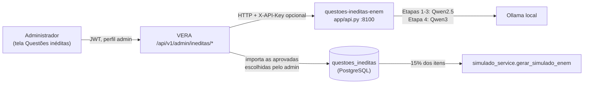

# Questões Inéditas: Serviço Externo de Geração e Importação pelo Administrador

A geração de questões inéditas **não roda mais na plataforma**. O pipeline PoT foi para o repositório próprio `questoes-ineditas-enem`, onde foram feitos os experimentos de seleção dos modelos. Ele inclui:
- o RAG *few-shot*, com as questões históricas;
- o *solver* Python executado em sandbox, com o nexo numérico e a montagem das alternativas por código;
- a resolução cega, o confronto e a auditoria pedagógica.

Nesse repositório, o pipeline é exposto como uma API HTTP mínima. A VERA guarda e usa o acervo (`questoes_ineditas`) e oferece ao administrador uma tela para pedir lotes ao serviço e importar as questões aprovadas.

Decisão de 2026-11-16: o código da primeira versão da geração dentro da plataforma foi removido, para não haver duas implementações divergentes. Saíram cerca de 3.000 linhas:
- `question_service.py`, `code_executor.py`, `question_validator.py` e `schemas/question.py`;
- a rota `/questoes/ineditas`;
- os scripts de povoamento e do namespace `questoes_enem` do Pinecone;
- o bloco de prompts da geração.

As 253 questões já existentes no acervo foram mantidas.

---

## 1. Fluxo

1. **Lote:** o administrador escolhe as habilidades (as 28 ativas, já sem H06 e H20, ou parte delas), a quantidade por habilidade e o número máximo de tentativas por questão.
2. **Geração:** o serviço gera em segundo plano, um lote por vez. Em cada tentativa:
   - o Qwen 2.5 faz as Etapas 1 a 3;
   - o Qwen3, sem raciocínio, faz a Etapa 4.
   O pedido para na primeira questão aprovada. É a configuração escolhida nos Experimentos 1 e 2, e leva cerca de 11 minutos por questão aprovada.
3. **Acompanhamento:** a tela consulta o lote a cada 5 segundos e mostra o andamento de cada pedido.
4. **Revisão e importação:** o administrador abre a pré-visualização de cada aprovada e adiciona ao acervo as que quiser. A importação não é automática, porque a validação automática não barra todos os erros de conteúdo.

## 2. Rotas da VERA (`app/api/v1/admin_ineditas.py`, todas com `require_admin`)

| Rota | O que faz |
|---|---|
| `GET /admin/ineditas/saude` | Estado do serviço e modelos configurados |
| `GET /admin/ineditas/habilidades` | As 28 habilidades ativas |
| `POST /admin/ineditas/lotes` | `{habilidades: [...] ou "all", quantidade, max_tentativas}` |
| `GET /admin/ineditas/lotes/{id}` | Andamento, com `no_acervo` em cada questão aprovada |
| `POST /admin/ineditas/lotes/{id}/cancelar` | Para o lote depois do pedido atual |
| `POST /admin/ineditas/importar` | `{lote_id, questao_ids}` |

**Regras da importação:**
- Só entram questões **aprovadas daquele lote**. Qualquer outra devolve 409.
- Cada questão é gravada com o **mesmo UUID** que tem no serviço. Por isso, importar de novo não duplica nada.

**Erros:**
- Serviço fora do ar devolve 503.
- Qualquer outro erro do serviço é repassado com o status e a mensagem originais.

## 3. Compatibilidade do formato

As questões aprovadas pelo serviço já têm os campos e formatos da tabela `questoes_ineditas`, e nenhuma migração foi necessária:
- habilidade no formato `H01`;
- alternativas `{A..E}` em texto, no padrão brasileiro;
- gabarito como letra;
- justificativa não vazia;
- `thought_scratchpad` com o planejamento e o solver.

O enunciado pode trazer uma tabela em Markdown, que o `MathText.tsx` renderiza.

## 4. Configuração

- **VERA (`app/core/config.py`):**
  - `QUESTOES_API_URL`, com padrão `http://127.0.0.1:8100`;
  - `QUESTOES_API_KEY`, opcional;
  - `QUESTOES_API_TIMEOUT_SECONDS`.
- **Serviço (`.env` do `questoes-ineditas-enem`):**
  - `MODELO_GERADOR`, `MODELO_AVALIADOR` e `AVALIADOR_THINK`;
  - `API_KEY`, que deve ser igual à `QUESTOES_API_KEY` da VERA quando for usada;
  - `API_MOCK=true`, que faz o serviço funcionar sem Ollama, só para testes.
- **Para subir o serviço:** `./.venv/bin/uvicorn app.api:app --host 127.0.0.1 --port 8100`, a partir da raiz do repositório.

Os detalhes do pipeline e dos experimentos estão no `CLAUDE.md` e em `docs/` do repositório `questoes-ineditas-enem`.
