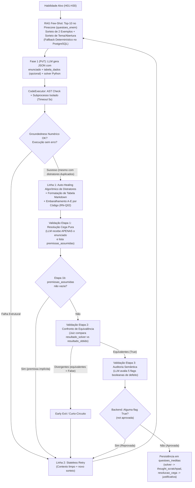

# Pipeline PoT de Geração e Validação de Questões Inéditas

Para erradicar erros aritméticos, colisões de alternativas e viés de confirmação (*sycophancy*) em modelos locais de 7B parâmetros, a criação de questões inéditas de Matemática adota a arquitetura **Program-Aided Generation (PoT)** aliada a uma **Validação Modular em 3 Etapas**.

---

## 1. Fluxo Completo de Geração e Validação

---

## 2. Regras de Negócio da Geração PoT (`RN-Q01` a `RN-Q04`)

### `RN-Q01` — Validação Estrita Multicamadas (Código + 3 Etapas LLM)
Nenhuma questão inédita pode ser salva ou exibida ao estudante sem cumprir **todos** os 7 critérios abaixo:
1. **Execução limpa da função `def resolver()`**: executada em processo filho isolado (`subprocess.run`) com timeout de **5 segundos** (`execute_solver_code` em `app/services/code_executor.py`), retornando dicionário com `"correta"` e `"distratores"` (4 itens).
2. **Inspeção Estática de Segurança via AST (`check_code_safety`)**:
   - Bloqueia imports de módulos do sistema/rede (`BLOCKED_MODULES`: `os`, `sys`, `subprocess`, `socket`, `shutil`, `urllib`, `requests`, `http`, `pathlib`, `ctypes`, `pickle`, `sqlite3`, etc.).
   - Bloqueia chamadas de funções perigosas (`BLOCKED_CALLS`: `eval`, `exec`, `compile`, `__import__`, `open`, `getattr`, `setattr`, `input`, `exit`, `breakpoint`).
3. **Nexo Numérico (*Groundedness* — `validate_solver_consistency` / `_extract_correta_code_numbers`)**:
   - Realiza *backward slicing* na AST de `resolver()` a partir da expressão de `"correta"`, extraindo apenas os literais numéricos (`ast.Constant`) que participam direta ou indiretamente do cálculo do gabarito (isentando constantes auxiliares exclusivas das variáveis de `"distratores"`, o que evita falsos positivos sem enfraquecer o rigor do cálculo principal) e verifica se cada número consta no `enunciado` ou na `tabela_dados`.
   - Apenas constantes matemáticas/geométricas/temporais neutras (`ALLOWED_NUMERIC_CONSTANTS`: `0, 1, 2, 3, 4, 5, 10, 12, 24, 60, 100, 180, 360, 1000, 0.5, 0.1, 0.01, 3.14, 3.1415, 3.1416`) são isentas.
   - **Convenções não são constantes neutras** (`DSR-07`): `365` foi removido da lista; "ano = 365 dias", "mês = 30 dias" etc. só podem ser usados no solver se declarados no enunciado.
4. **Unicidade Estrita das 5 Alternativas**: a resposta correta e os 4 distratores devem resultar em 5 strings formatadas mutuamente exclusivas.
5. **Validação Etapa 1 — Resolução Cega Pura (`QuestaoBlindSolvingOutput`)**:
   - O LLM resolve o problema recebendo **exclusivamente o enunciado** (sem alternativas e sem gabarito), produzindo `resolucao_passo_a_passo`, `premissas_assumidas` e `resultado_obtido` (em tipo primitivo Python: `int`, `float`, `str`, `dict` ou `list`).
   - **Etapa 1b — Premissas Implícitas com *Early Exit* (`DSR-07`)**: o resolvedor lista toda suposição/convenção que precisou adotar sem estar escrita no enunciado (exceto conversões universais: 1 h = 60 min, 1 dia = 24 h, 1 ano = 12 meses, prefixos métricos). Se `premissas_assumidas` não for vazia (após normalização de marcadores como `"Nenhuma"`/`"N/A"`), o backend reprova deterministicamente e aciona o *Stateless Retry* sem chamar a Etapa 2.
6. **Validação Etapa 2 — Confronto Direto de Equivalência com *Early Exit* (`QuestaoEquivalenciaOutput`)**:
   - Compara `resultado_solver` vs. `resultado_obtido` aceitando equivalências matemáticas legítimas (ex.: `2500` vs. `"R$ 2.500,00"`, `0.5` vs. `"50%"`, arredondamentos compatíveis). Se `equivalentes == False`, interrompe imediatamente (*Early Exit*) e aciona o *Stateless Retry*.
7. **Validação Etapa 3 — Auditoria Semântica Determinística (`QuestaoAuditoriaSemanticaOutput`)**:
   - Avalia 5 flags booleanas de defeito:
     - `possui_incoerencia`: contradições físicas, matemáticas ou de senso comum.
     - `possui_ambiguidade`: comando duplo ou margem para mais de uma interpretação.
     - `deficit_informacoes`: omissão de dado indispensável para o cálculo **ou dependência de convenção não declarada** (ex.: "mensal" tratado como 30 dias).
     - `erros_ou_vazamentos`: erros gramaticais graves ou vazamento de termos internos (`"solver"`, `"python"`, `"código"`, `"função"`).
     - `duplicacao_tabelas`: repetição redundante da tabela no texto e em `tabela_dados`.
   - A aprovação (`aprovada = not any(...)`) e o `motivo_rejeicao` são calculados em Python no backend.

### Diretrizes de Geração da Fase 1 (`POT_QUESTION_GENERATOR_SYSTEM_PROMPT` — `DSR-07`)
- **Complexidade padrão ENEM**: no mínimo 2 etapas de raciocínio encadeadas e 2 conceitos articulados; proibidas questões de operação única (ex.: somar uma coluna, aplicar uma porcentagem isolada). Com referências RAG, o item isomórfico não pode ser simplificado.
- **Premissas explícitas**: toda convenção (dias do mês/ano, semanas por mês, regime de juros, arredondamento, π, litro/m³, constância de taxas) deve ser declarada no enunciado ("Considere que...").
- **Distratores por erros típicos**: o solver modela erros de raciocínio (parar em etapa intermediária, esquecer conversão, usar parte dos dados), não variações arbitrárias (`±50`, `×1,2`).
- **Few-shot multi-etapas**: o exemplo de formato (`POT_FEW_SHOT_EXAMPLE`) é um item de 3 etapas com premissas declaradas, substituindo o antigo exemplo de soma simples que ancorava o modelo 7B em itens triviais. O orçamento da Fase 1 é de `max_tokens=1536`.
- **Ancoragem RAG com valor real da resposta**: nos 2 exemplos históricos do RAG (`exemplos_referencia`), `build_enunciado_solver_prompt` resolve `alternativas[gabarito]` e injeta `Resposta Correta Oficial: <valor>` (ou omite a linha caso o texto da alternativa não esteja disponível), eliminando a letra isolada (`Gabarito Oficial: B`) que não trazia significado matemático nem correspondia ao contrato PoT (que proíbe letras A–E na Fase 1).

### `RN-Q02` — Atribuição Determinística de Alternativas e Gabarito
- O LLM **nunca** escolhe a letra do gabarito na geração PoT.
- A função `assemble_alternatives_and_gabarito` (`app/services/code_executor.py`) formata os números no padrão brasileiro (`format_number`: inteiros limpos ou decimais com vírgula até 2 casas), embaralha as 5 opções com `random.shuffle` e atribui deterministicamente as letras `"A"` a `"E"`, identificando a letra exata correspondente a `correta`.

### `RN-Q03` — Defesa em Cascata: Auto-Healing Algorítmico e Stateless Retry
- **Linha 1 (`auto_heal_distractors`)**: quando `resolver()` acerta o cálculo principal mas produz distratores repetidos ou iguais à correta, o backend preserva os distratores únicos e sintetiza os faltantes deterministicamente usando o passo característico $\Delta$ da distribuição e variações cognitivas típicas do ENEM ($\pm k\Delta$, dobro/metade, escala decimal $\times 10$ / $\div 10$).
- **Linha 2 (*Stateless Retry*)**: em caso de falha estrutural na Fase 1 ou reprovação nas Etapas 1b/2/3 da validação, descarta-se toda a tentativa e inicia-se uma nova iteração com contexto limpo, novo sorteio de tema/abertura (`sortear_contexto_criativo`), nova amostragem dos Top-10 candidatos no Pinecone e progressão gradual de temperatura a partir de `0.0` (`0.0` $\rightarrow$ `0.1` $\rightarrow$ `0.2` $\rightarrow$ `0.3`, limitada a `0.6`).

### `RN-Q04` — Rastreabilidade e Auditoria na Persistência
- Na tabela `questoes_ineditas`:
  - A coluna `thought_scratchpad` armazena o código Python de `def resolver()`.
  - A coluna `justificativa` armazena a `resolucao_passo_a_passo` gerada de forma independente na Resolução Cega Pura.

---

## 3. Contratos Técnicos de Sanitização e Formatação (`question_validator.py`)

1. **Sanitização de Colisões LaTeX em JSON (`sanitize_latex_json_text` e `sanitize_parsed_dict_values`)**:
   - Em JSON padrão, sequências como `\frac`, `\times`, `\right`, `\neq`, `\bar` e `\beta` colidem com caracteres de escape (`\f` form-feed `chr(12)`/`\x0c`, `\t` tab, `\r` carriage return, `\n` newline, `\b` backspace), corrompendo `\frac{a}{b}` para `\x0crac{a}{b}`.
   - O validador intercepta a string bruta antes de `json.loads()`, restaura `\x0crac` para `\\frac`, escapa barras simples de comandos LaTeX e limpa recursivamente o dicionário resultante.
2. **Formatação Estruturada de Tabelas (`tabela_dados` $\rightarrow$ Markdown)**:
   - Quando a questão envolve dados tabulares, o LLM preenche o campo opcional `tabela_dados: List[Dict[str, Any]]`.
   - A função `format_enunciado_with_table` converte `tabela_dados` em uma tabela Markdown limpa e a incorpora ao `enunciado` (evitando duplicação caso o modelo já tenha desenhado pipes `|` no texto).

---

## Notas Relacionadas

- [Decisões de Engenharia DSR (Decisões 3, 4, 5 e 6)](../00-fundamentos/decisoes-dsr.md)
- [Modelo de Dados Relacional (`questoes_ineditas`)](../01-arquitetura-e-dados/modelo-relacional.md)
- [Guia Operacional e Scripts (`populate_questoes_ineditas.py`)](../04-operacoes-e-roadmap/guia-operacional-e-scripts.md)
