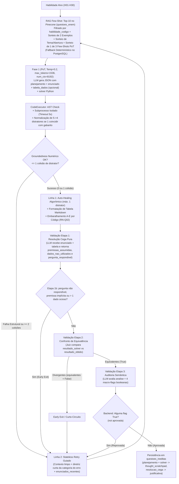

# Pipeline PoT de Geração e Validação de Questões Inéditas

Para erradicar erros aritméticos, colisões de alternativas e viés de confirmação (*sycophancy*) em modelos locais de 7B parâmetros, a criação de questões inéditas de Matemática adota a arquitetura **Program-Aided Generation (PoT)** aliada a uma **Validação Modular em 3 Etapas**.

---

## 1. Fluxo Completo de Geração e Validação

---

## 2. Regras de Negócio da Geração PoT (`RN-Q01` a `RN-Q04`)

### `RN-Q01` — Validação Estrita Multicamadas (Código + 3 Etapas LLM com Temperatura 0.0)
Nenhuma questão inédita pode ser salva ou exibida ao estudante sem cumprir **todos** os 7 critérios abaixo:
1. **Execução limpa da função `def resolver()`**: executada em processo filho isolado (`subprocess.run`) com timeout de **5 segundos** (`execute_solver_code` em `app/services/code_executor.py`), retornando dicionário com `"correta"` e `"distratores"` (4 itens; caso o modelo retorne 5 itens em `"distratores"` sendo 1 igual a `"correta"`, o item coincidente é descartado para reaproveitar os 4 distratores legítimos).
2. **Inspeção Estática de Segurança via AST (`check_code_safety`)**:
   - Bloqueia imports de módulos do sistema/rede (`BLOCKED_MODULES`: `os`, `sys`, `subprocess`, `socket`, `shutil`, `urllib`, `requests`, `http`, `pathlib`, `ctypes`, `pickle`, `sqlite3`, etc.).
   - Bloqueia chamadas de funções perigosas (`BLOCKED_CALLS`: `eval`, `exec`, `compile`, `__import__`, `open`, `getattr`, `setattr`, `input`, `exit`, `breakpoint`).
3. **Nexo Numérico (*Groundedness* — `validate_solver_consistency`)**:
   - Extrai todos os literais numéricos do corpo de `resolver()` (antes do `return`) e verifica se cada número consta explicitamente no texto do `enunciado` (incluindo números e termos multiplicativos/fracionários por extenso de `zero` a `mil` convertidos via `_WORDS_TO_NUMBERS`, além de complementos percentuais) ou na `tabela_dados`.
   - Apenas constantes matemáticas/geométricas/temporais neutras (`ALLOWED_NUMERIC_CONSTANTS`: `0, 1, 2, 3, 4, 5, 10, 12, 24, 60, 100, 180, 360, 1000, 0.5, 0.1, 0.01, 3.14, 3.1415, 3.1416`) são isentas.
   - **Convenções não são constantes neutras** (`DSR-07`): `365` foi removido da lista; "ano = 365 dias", "mês = 30 dias" etc. só podem ser usados no solver se declarados no enunciado.
4. **Unicidade Estrita das 5 Alternativas**: a resposta correta e os 4 distratores devem resultar em 5 strings formatadas mutuamente exclusivas (admitindo *Auto-Healing* para no máximo 1 distrator em colisão).
5. **Validação Etapa 1 — Resolução Cega Pura (`QuestaoBlindSolvingOutput`, `temperature=0.0`)**:
   - O LLM resolve o problema recebendo **exclusivamente o enunciado e a tabela** (sem alternativas e sem gabarito), produzindo `resolucao_passo_a_passo`, `premissas_assumidas`, `dados_nao_utilizados`, `pergunta_respondivel` e `resultado_obtido` (em tipo primitivo Python).
   - **Etapa 1b — Checagem de Respondibilidade, Premissas Implícitas e Dados Ociosos com *Early Exit* (`DSR-07`)**:
     - Se `pergunta_respondivel == False`, reprova imediatamente.
     - Se `premissas_assumidas` não for vazia (após normalização de marcadores como `"Nenhuma"`/`"N/A"`), reprova deterministicamente.
     - Se `dados_nao_utilizados` apontar **$> 1$ dado/coluna não utilizado** no cálculo (violando o limite máximo de 1 coluna/dado extra contextual), reprova deterministicamente e aciona o *Stateless Retry* antes da Etapa 2.
6. **Validação Etapa 2 — Confronto Direto de Equivalência com *Early Exit* (`QuestaoEquivalenciaOutput`, `temperature=0.0`)**:
   - Compara `resultado_solver` vs. `resultado_obtido` aceitando equivalências matemáticas legítimas (ex.: `2500` vs. `"R$ 2.500,00"`, `0.5` vs. `"50%"`, arredondamentos compatíveis). Se `equivalentes == False`, interrompe imediatamente (*Early Exit*) e aciona o *Stateless Retry*.
7. **Validação Etapa 3 — Auditoria Semântica Determinística (`QuestaoAuditoriaSemanticaOutput`, `temperature=0.0`)**:
   - Checagens mecânicas estruturais (como termos proibidos de bastidores: `"solver"`, `"python"`, `"código"`) são validadas deterministicamente em Python (`check_prohibited_terms`) com 0ms antes das chamadas LLM.
   - O LLM na Etapa 3 avalia `analise` + exclusivamente 4 macro-critérios semânticos e contextuais humanos:
     - `incoerencia_ou_absurdo`: contradições físicas, bom senso ou erro conceitual grave.
     - `comando_ambiguo_ou_incompativel`: comando duplo, omissão de unidade esperada ou pergunta incompatível com alternativas numéricas.
     - `deficit_ou_contradicao`: omissão de dado essencial ou contradição entre texto e tabela.
     - `complexidade_insuficiente`: item trivial abaixo do padrão ENEM.
   - A aprovação (`aprovada = not any(...)`) e o `motivo_rejeicao` são calculados em Python no backend.

### Diretrizes de Geração da Fase 1 (`POT_QUESTION_GENERATOR_SYSTEM_PROMPT` — `DSR-07`)
- **Janela de Contexto e Orçamento**: `num_ctx=8192` e `max_tokens=1536` na Fase 1 para evitar truncamento das regras do prompt ou do JSON de saída.
- **Temperatura Base 0.2**: A geração inicia em `temperature=0.2` (evitando cópia determinística do *few-shot* na 1ª tentativa) e escala `+0.1` por retry até `0.6`, enquanto as 3 etapas de validação operam estritamente em `temperature=0.0`.
- **Planejamento Obrigatório (`planejamento`)**: a primeira chave do JSON obriga o modelo a estruturar dados, etapas de raciocínio ($\ge 2$) e erros típicos antes de redigir `enunciado` e `solver`.
- **Complexidade padrão ENEM e Premissas explícitas**: no mínimo 2 etapas de raciocínio encadeadas; toda base, área ou peso deve estar declarado; distratores modelados por variáveis nomeadas de erros típicos.
- **Banco de 3 Few-Shots Multi-Etapas (`POT_FEW_SHOT_EXAMPLES`)**: sorteia 1 dentre 3 exemplos canônicos (média ponderada com `len([...])`, porcentagens sucessivas e área/custo com tabela) via `sortear_few_shot()`.
- **Ancoragem RAG com valor real da resposta**: nos 2 exemplos históricos do RAG (`exemplos_referencia`), `build_enunciado_solver_prompt` resolve `alternativas[gabarito]` e injeta `Resposta Correta Oficial: <valor>`.

### `RN-Q02` — Atribuição Determinística de Alternativas e Gabarito
- O LLM **nunca** escolhe a letra do gabarito na geração PoT.
- A função `assemble_alternatives_and_gabarito` (`app/services/code_executor.py`) formata os números no padrão brasileiro (`format_number`: inteiros limpos ou decimais com vírgula até 2 casas), embaralha as 5 opções com `random.shuffle` e atribui deterministicamente as letras `"A"` a `"E"`, identificando a letra exata correspondente a `correta`.

### `RN-Q03` — Defesa em Cascata: Auto-Healing Limitado (Máx. 1 Colisão) e Stateless Retry Guiado
- **Linha 1 (`auto_heal_distractors` limitado a 1 distrator)**:
  - Se o solver retornar 5 itens em `distratores` sendo 1 igual a `correta`, o item coincidente é descartado (`_normalize_five_distractors`), preservando os 4 distratores calculados por erros típicos.
  - Se, dentre os 4 distratores, houver **apenas 1 colisão** (`3` distratores únicos distintos de `correta`), o backend cura esse único distrator deterministicamente em `0ms`. Se houver **$\ge 2$ colisões**, a tentativa é reprovada imediatamente para evitar alternativas artificiais em série.
- **Linha 2 (*Stateless Retry* Guiado sem Ancoragem)**: em caso de falha estrutural na Fase 1 ou reprovação nas Etapas 1b/2/3 da validação, descarta-se toda a tentativa e inicia-se uma nova iteração (até `max_attempts=5`) com contexto limpo, novo sorteio de tema/abertura (`sortear_contexto_criativo`), nova amostragem dos Top-10 candidatos no Pinecone, **escalonamento dinâmico de temperatura** (`curr_temp = min(0.2 + 0.1 * (attempt - 1), 0.6)`), lista de `enunciados_recentes` da habilidade e **apenas uma diretriz curta da categoria do erro anterior** (`_classify_retry_hint`), orientando sem ancorar.

### `RN-Q04` — Rastreabilidade e Auditoria na Persistência
- Na tabela `questoes_ineditas`:
  - A coluna `thought_scratchpad` armazena o `planejamento` e o código Python de `def resolver()`.
  - A coluna `justificativa` armazena a `resolucao_passo_a_passo` gerada de forma independente na Resolução Cega Pura.

---

## 3. Contratos Técnicos de Sanitização e Formatação (`question_validator.py`)

1. **Sanitização de Colisões LaTeX em JSON (`sanitize_latex_json_text` e `sanitize_parsed_dict_values`)**:
   - Em JSON padrão, sequências como `\frac`, `\times`, `\right`, `\neq`, `\bar` e `\beta` colidem com caracteres de escape (`\f` form-feed `chr(12)`/`\x0c`, `\t` tab, `\r` carriage return, `\n` newline, `\b` backspace), corrompendo `\frac{a}{b}` para `\x0crac{a}{b}`.
   - O validador intercepta a string bruta antes de `json.loads()`, restaura `\x0crac` para `\\frac`, escapa barras simples de comandos LaTeX e limpa recursivamente o dicionário resultante.
2. **Formatação Estruturada de Tabelas (`tabela_dados` $\rightarrow$ Markdown)**:
   - Quando a questão envolve dados tabulares, o LLM preenche o campo opcional `tabela_dados: List[Dict[str, Any]]`.
   - A função `format_enunciado_with_table` converte `tabela_dados` em uma tabela Markdown limpa e a incorpora ao `enunciado` (evitando duplicação caso o modelo já tenha desenhado pipes `|` no texto).

---

## Notas Relacionadas

- [Decisões de Engenharia DSR (Decisões 3, 4, 5 e 6)](../00-fundamentos/decisoes-dsr.md)
- [Modelo de Dados Relacional (`questoes_ineditas`)](../01-arquitetura-e-dados/modelo-relacional.md)
- [Guia Operacional e Scripts (`populate_questoes_ineditas.py`)](../04-operacoes-e-roadmap/guia-operacional-e-scripts.md)
