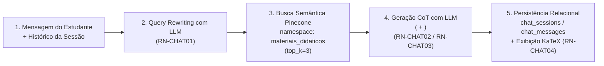

# Fluxo da Tutora Virtual VERA (Tutoria RAG Interativa)

A Tutora Virtual VERA oferece acompanhamento pedagógico conversacional multiturno, combinando recuperação semântica no acervo de materiais didáticos com raciocínio estruturado *Chain-of-Thought* (`<pensamento>`).

---

## 1. Pipeline de Execução em 5 Etapas (`ChatService`)

---

## 2. Regras de Negócio da Tutoria (`RN-CHAT01` a `RN-CHAT04`)

### `RN-CHAT01` — Reescrita Contextual de Consultas (*Query Rewriting*)
- **Objetivo**: Resolver anáforas, pronomes demostrativos ou referências implícitas ao turno anterior (ex.: *"E se o expoente fosse negativo?"* ou *"Não entendi o segundo passo"*) antes de consultar o Pinecone.
- **Funcionamento (`ChatService.rewrite_query` / `arewrite_query`)**:
  - Controlado pela flag `settings.ENABLE_QUERY_REWRITING` (padrão `True`).
  - Se não houver histórico prévio na sessão (`not history_msgs` e `force=False`), a mensagem original é usada diretamente, economizando uma chamada ao LLM.
  - Quando há histórico, `build_query_rewrite_prompt` (`app/core/prompts.py`) instrui o LLM (`temperature=0.0`, `max_tokens=60`) a produzir uma query autocontida focada no conceito matemático do ENEM.
  - `clean_rewritten_query` sanitiza a saída removendo prefixos ou aspas residuais; em caso de falha, faz fallback seguro para a mensagem original do estudante.

### `RN-CHAT02` — Scratchpad Pedagógico Obrigatório (`<pensamento>`)
- A inferência principal da tutora é executada com **`temperature=0.2`** (definida explicitamente em `ChatService.send_message` e `asend_message`), equilibrando a empatia e didática dialógica com o rigor conceitual da Matemática do ENEM.
- O prompt de sistema construído por `build_chat_prompt` (`app/core/prompts.py`) exige que o modelo estruturado emita obrigatoriamente dois blocos XML:
  1. `<pensamento>...</pensamento>`: onde a tutora realiza cálculos intermediários, confere sinais algébricos, analisa os chunks recuperados do Pinecone e planeja a estratégia didática antes de responder.
  2. `<resposta>...</resposta>`: explicação final clara, acolhedora e passo a passo voltada ao estudante.

### `RN-CHAT03` — Parsing, Extração e Sanitização de Tags CoT
- A função `parse_cot_response` (`app/core/prompts.py`) separa o conteúdo de `<pensamento>` e `<resposta>`.
- **Garantia de Limpeza**:
  - O campo `thought` é salvo separadamente na coluna `chat_messages.thought` e retornado no payload da API para exibição em componente retrátil (*accordion* "Ver raciocínio da VERA") no frontend.
  - O campo `reply` (`content`) é limpo de quaisquer tags XML residuais (`<pensamento>`, `</pensamento>`, `<resposta>`, `</resposta>`), mesmo quando o modelo gera tags parcialmente malformadas.

### `RN-CHAT04` — Padronização de Notação Matemática (LaTeX / KaTeX)
- Toda expressão matemática gerada pela tutora deve utilizar delimitadores LaTeX compatíveis com o componente `MathText.tsx` do frontend:
  - `$...$` para fórmulas inline (ex.: $\Delta = b^2 - 4ac$).
  - `$$...$$` para blocos de equações em destaque (*display math*).

---

## 3. Gerenciamento de Sessão Híbrido (PostgreSQL + Fallback RAM)

- **Modo Persistente (Produção / Estudante Autenticado)**:
  - Sessões são gravadas em `chat_sessions` com título gerado automaticamente a partir da primeira pergunta (`generate_session_title`, até 40 caracteres).
  - Cada turno grava o par de mensagens (`role="user"` e `role="assistant"`) em `chat_messages`, persistindo também a lista de `context_chunks` (JSONB com `id`, `title`, `topic`, `text`, `score`, `page_number`, `document_name`).
- **Modo Volátil em Memória (`ChatSessionManager`)**:
  - Mantém janela deslizante em RAM (`max_history_turns = 12`) como fallback para testes unitários desacoplados do banco relacional.

---

## Notas Relacionadas

- [Decisões de Engenharia DSR (Decisão 2)](../00-fundamentos/decisoes-dsr.md)
- [Pipeline de Ingestão e Banco Vetorial (Pinecone)](../01-arquitetura-e-dados/ingestao-e-vetorizacao.md)
- [Frontend e Experiência do Usuário](./frontend-e-ux.md)
